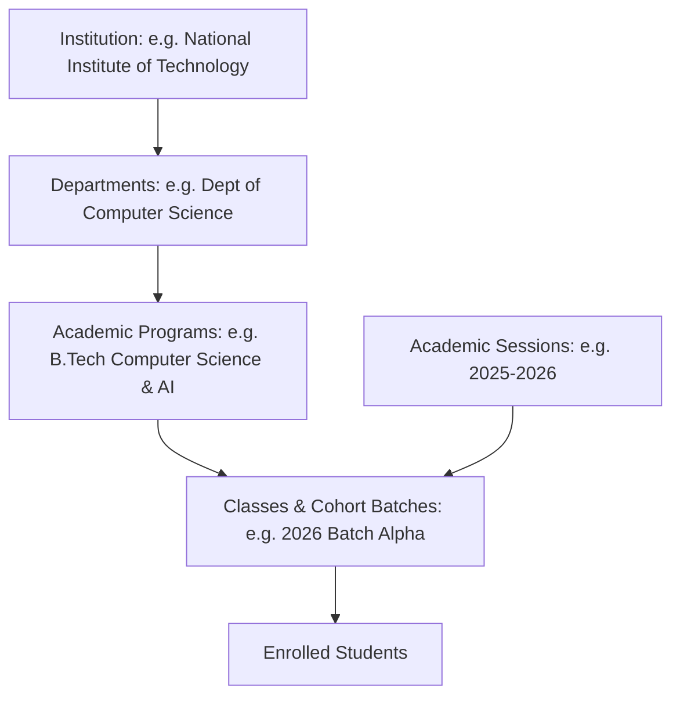

# KAABIL (काबिल) — Academic Structure & Disciplinary Hierarchy Guide

## 1. 4-Tier Academic Hierarchy

KAABIL models universal educational organization through a clean 4-tier relational structure:

### Tier 1: Academic Departments (`/institution/departments`)
- Represents academic divisions (e.g. Department of Mechanical Engineering, Department of Cardiology, Department of Fine Arts).
- Associated with one of the 13 educational stream categories.
- Tracks assigned Head of Department (HOD) and contact information.

### Tier 2: Academic Programs (`/institution/programs`)
- Represents specific degrees, diplomas, or school stages (e.g. B.Tech, MBBS, MBA, Class 10 CBSE, ITI Electrician Certificate).
- Configured with Education Stage (`CLASS_8_10`, `HIGHER_SECONDARY`, `DIPLOMA`, `UNDERGRADUATE`, `POSTGRADUATE`, `DOCTORAL`, `VOCATIONAL`).
- Configured with duration in years (1 to 6) and total semesters/terms.

### Tier 3: Academic Sessions (`/institution/sessions`)
- Represents academic calendar years (e.g. "2025–2026 Academic Year").
- Features a single active `isCurrent` boolean flag to cleanly delineate active terms from historical cohorts.

### Tier 4: Classes & Cohort Batches (`/institution/classes`)
- Specific classroom cohorts with max capacity (e.g. 60 students).
- Configured with semester or year number (e.g. Sem 3), section name ("A", "B"), and fill percentage indicators.
