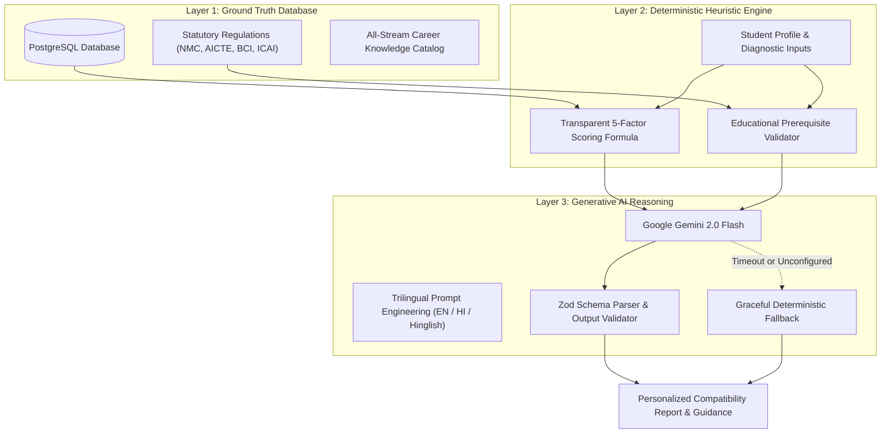

# KAABIL — Hybrid AI Integration Architecture (Docs)

## 1. Architectural Philosophy

KAABIL rejects the reckless "pure LLM chatbot" approach to career counseling. Career decisions in India carry enormous financial, social, and emotional consequences for students and families. Unchecked generative AI can hallucinate admission deadlines, create nonexistent degree shortcuts, or recommend careers incompatible with regulatory eligibility.

Therefore, KAABIL employs a **3-Layer Hybrid AI Architecture**:



---

## 2. Google Gemini 2.0 Flash Integration

KAABIL utilizes the official `@google/generative-ai` SDK (`^0.24.1`) connected to `gemini-2.0-flash`.

### Key Technical Parameters:
- **Model**: `gemini-2.0-flash`
- **Temperature**: `0.2` (Low temperature for deterministic, factual consistency)
- **Top-K**: `40`
- **Top-P**: `0.85`
- **Timeout**: `8,000 ms` via `AbortSignal.timeout`
- **Retries**: Maximum 2 bounded exponential-backoff retries on transient network errors
- **Response Format**: Strict JSON mode (`responseMimeType: "application/json"`)
- **Telemetry**: Every call logs prompt tokens, response tokens, duration, and status to `AiUsageLog`.

---

## 3. Strict Schema Validation with Zod

All generative AI responses must parse against strict Zod schemas before being served to users:

```typescript
export const GeminiRecommendationOutputSchema = z.object({
  personalizedInsights: z.array(
    z.object({
      careerSlug: z.string(),
      reasons: z.array(z.string().min(5)),
      bridgeAdvice: z.string().optional(),
      growthObservation: z.string(),
    })
  ),
  overallGuidanceSummary: z.string().min(20),
  languageUsed: z.enum(["en", "hi", "hinglish"]),
  confidenceScore: z.number().min(0).max(100),
});
```

If the LLM output violates the schema or times out, the engine **never crashes**. It automatically falls back to Layer 2 deterministic text generation, logging the fallback event to `AiUsageLog`.

---

## 4. Trilingual Career Reasoning (EN, HI, Hinglish)

Indian students come from diverse linguistic backgrounds. KAABIL provides native reasoning in three modes:

1. **English (`en`)**: Formal academic English referencing official statutory bodies, entrance exams, and college standards.
2. **Hindi (`hi`)**: Clear, empathetic, and culturally grounded Hindi (हिंदी) explaining complex medical/legal/technical career concepts simply.
3. **Hinglish (`hinglish`)**: Conversational bilingual Indian English-Hindi ("Aapka interest AI aur robotics me strong hai, isliye JEE PCM pathway optimal rahega").

---

## 5. Free-First Development & Transparent Fallback

In accordance with KAABIL's core architectural guidelines:
- If `GEMINI_API_KEY` is not present in `.env`, the system **never simulates fake AI calls**.
- It activates the **Transparent Deterministic Fallback Mode**.
- UI cards explicitly display the badge: `Deterministic Multi-Factor Recommendation (Free Offline Mode)`.
- Students and evaluators can use 100% of the platform's core matching capabilities without requiring an external paid API subscription.
