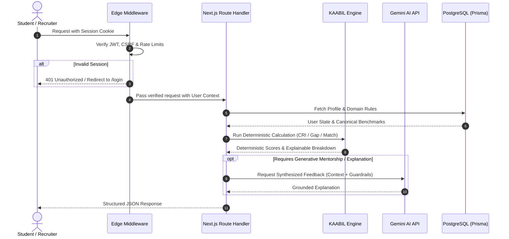

# ARCHITECTURE.md — System Architecture & Engineering Blueprint

## Project: KAABIL (काबिल)
**Architecture Style:** Production-Oriented Modular Monolith  
**Runtime:** Next.js 15 (Node.js LTS, App Router) with Strict TypeScript  
**Database:** PostgreSQL 16+ via Prisma ORM & Redis Cache  
**Authentication:** Auth.js (NextAuth v5) with Server-Side RBAC  
**AI Services:** Google Gemini API with Structured Zod Validation  

---

## 1. High-Level Architectural Vision

KAABIL is built as a **scalable, production-oriented modular monolith**. By leveraging Next.js App Router, Route Handlers, Server Actions, and React Server Components, we eliminate the complexity, network overhead, and infrastructure cost of distributed microservices while maintaining strict internal domain boundaries.

```
                                  [ CLIENT APPS / USERS ]
                                             │
                                             ▼
                 ┌────────────────────────────────────────────────────────┐
                 │           Next.js Edge Middleware & Security           │
                 │   (CSRF, Rate Limiting, Session Auth, Tenant Guard)    │
                 └───────────────────────────┬────────────────────────────┘
                                             │
                 ┌───────────────────────────┴────────────────────────────┐
                 │               Next.js App Router (UI Layer)            │
                 │  ┌───────────────┬──────────────┬──────────────┬───────┤
                 │  │ (marketing)   │ (student)    │ (institution)│ (emp) │
                 │  │ (auth)        │              │              │ (adm) │
                 │  └───────────────┴──────────────┴──────────────┴───────┘
                 └───────────────────────────┬────────────────────────────┘
                                             │
                 ┌───────────────────────────┴────────────────────────────┐
                 │          Unified Backend API & Server Actions          │
                 │   (REST Route Handlers `/api/...` & Action Handlers)   │
                 └───────────────────────────┬────────────────────────────┘
                                             │
      ┌──────────────────────────────────────┼──────────────────────────────────────┐
      │                                      │                                      │
      ▼                                      ▼                                      ▼
┌───────────────────────────┐  ┌───────────────────────────┐  ┌───────────────────────────┐
│   DOMAIN SERVICE LAYER    │  │  MODULAR AI ENGINES CORE  │  │   DATA & STORAGE LAYER    │
│  - User & Profile Service │  │  - Career Intelligence    │  │  - PostgreSQL (Prisma ORM)│
│  - Academic & Stream Svc  │  │  - Skill Graph & NLP      │  │  - Redis (Cache & Limits) │
│  - Institution Mgmt Svc   │  │  - Career Digital Twin    │  │  - S3-Compatible Storage  │
│  - Job & Recruitment Svc  │  │  - Readiness Index (CRI)  │  │                           │
│  - Verification Service   │  │  - Explainable Matcher    │  │                           │
│  - Audit & Governance Svc │  │  - Gemini AI Client       │  │                           │
└───────────────────────────┘  └───────────────────────────┘  └───────────────────────────┘
```

---

## 2. Next.js App Router Directory & Route Topology

The application uses isolated Next.js Route Groups `(...)` sharing a common design system, UI primitive library, and backend services.

```
src/app/
├── (marketing)/                # Public Marketing Pages
│   ├── page.tsx                # High-converting SaaS landing page
│   ├── about/                  # Mission, stream philosophy & founders
│   ├── careers-directory/      # Public career preview & search
│   └── privacy-terms/          # DPDP Act privacy policy & terms
├── (auth)/                     # Authentication & Flow Selection
│   ├── login/                  # Multi-role sign in
│   ├── register/               # Role-based onboarding selection
│   ├── verify-email/           # Email verification screen
│   └── forgot-password/        # Password recovery
├── (student)/                  # Student Portal (Role: STUDENT)
│   ├── dashboard/              # Holistic Student Dashboard
│   ├── onboarding/             # Dynamic intelligent onboarding
│   ├── mentor/                 # Trilingual AI Career Mentor
│   ├── stream-selection/       # Stream selector for Class 8-10
│   ├── explore-careers/        # Career discovery engine & filter
│   ├── career-compare/         # Multi-career comparison
│   ├── assessments/            # Psychometric & aptitude tests
│   ├── digital-twin/           # Dynamic Career Digital Twin
│   ├── skill-genome/           # AI Skill Genome & Competency Map
│   ├── skill-gap/              # Gap analyzer vs. benchmarks
│   ├── roadmap/                # Dynamic chronological roadmap
│   ├── weekly-plan/            # Micro-action weekly planner
│   ├── learning/               # Learning Academy & free resources
│   ├── missions/               # Daily 5-minute AI missions
│   ├── exams/                  # Entrance Exam Hub (NEET, JEE, CLAT)
│   ├── colleges/               # College & course explorer
│   ├── scholarships/           # Scholarship discovery engine
│   ├── eligibility-checker/    # Deterministic eligibility validator
│   ├── what-if/                # Career What-If scenario simulator
│   ├── challenges/             # Industry Project Challenge Hub
│   ├── passport/               # Verifiable Digital Skill Passport
│   ├── resume/                 # ATS-friendly Resume Studio
│   ├── interview-lab/          # AI Mock Interview environment
│   ├── jobs/                   # Verified internships & jobs (18+ only)
│   ├── applications/           # Kanban application tracker
│   └── settings/               # Account, guardian & privacy settings
├── (institution)/              # Institution Portal (Role: INSTITUTION_ADMIN, FACULTY)
│   ├── dashboard/              # Institution Command Center
│   ├── students/               # Student directory & bulk onboarding
│   ├── departments/            # Department & curriculum config
│   ├── faculty/                # Faculty management & permissions
│   ├── skill-analytics/        # Macro skill heatmaps & cohort gaps
│   ├── assessments/            # Internal diagnostic test management
│   ├── industry-intel/         # Real-time hiring demand insights
│   ├── interventions/          # Smart student intervention alerts
│   ├── training/               # Upskilling workshops & bootcamps
│   ├── placements/             # Campus placement coordination
│   ├── reports/                # NIRF/NAAC/NBA accreditation reports
│   └── settings/               # Institution domain & profile
├── (employer)/                 # Employer Portal (Role: EMPLOYER_ADMIN, RECRUITER)
│   ├── dashboard/              # Recruitment Command Center
│   ├── jobs/                   # Job vacancy management & skills
│   ├── discovery/              # Verified skill-based candidate search
│   ├── matching/               # Explainable AI talent matching
│   ├── challenges/             # Work trial challenge creation
│   ├── pipeline/               # Visual ATS recruitment pipeline
│   ├── interviews/             # Interview scheduling & scorecards
│   ├── verify-passport/        # Digital Skill Passport verification
│   ├── analytics/              # Hiring funnels & diversity stats
│   └── settings/               # Organization profile & verification
├── (admin)/                    # Admin Portal (Role: SUPER_ADMIN, CONTENT_ADMIN)
│   ├── dashboard/              # Executive platform health & KPIs
│   ├── users/                  # User management & role control
│   ├── institutions/           # Institution due-diligence verification
│   ├── employers/              # Corporate verification & anti-fraud
│   ├── career-cms/             # Dynamic taxonomy & career editor
│   ├── assessments/            # Central question & item bank
│   ├── job-moderation/         # Vacancy QA & scam protection
│   ├── ai-monitoring/          # Gemini API latency, cost & safety
│   ├── analytics/              # National stream & skill trends
│   ├── audit-logs/             # Immutable audit trail
│   └── settings/               # System configuration & feature flags
└── api/                        # Route Handlers
    ├── auth/[...nextauth]/     # NextAuth authentication endpoints
    ├── ai/                     # Gemini AI route handlers
    │   ├── mentor/             # Streaming conversational mentor
    │   ├── resume-critique/    # Structured resume feedback
    │   └── interview-agent/    # Mock interview dialogue
    ├── careers/                # Career taxonomy query & search
    ├── skills/                 # Skill extraction & graph endpoints
    ├── readiness/              # CRI computation & gap engine
    ├── passport/verify/        # Public passport verification endpoint
    └── webhooks/               # External event handling
```

---

## 3. Modular AI & Intelligence Engines

To ensure system maintainability and prevent spaghetti code, all intelligence capabilities are isolated inside `src/engines/`:

```
src/engines/
├── career/
│   ├── CareerDiscoveryEngine.ts     # Filters, stream alignments, search
│   ├── CareerComparisonEngine.ts    # Side-by-side metric normalization
│   └── EligibilityValidator.ts      # Strict regulatory criteria rules
├── stream/
│   ├── StreamRecommender.ts         # RIASEC + Subject interest matrix
│   └── AptitudeScorer.ts            # Psychometric dimension calculation
├── skill/
│   ├── SkillGraphEngine.ts          # Directed Acyclic Graph (DAG) of prerequisites
│   ├── NlpExtractor.ts              # Canonical alias normalizer + 3-gram cosine
│   └── SkillGapAnalyzer.ts          # Benchmark delta & priority queue
├── learning/
│   ├── RoadmapEngine.ts             # Dynamic milestone scheduler
│   └── AdaptivePlanner.ts           # Remediation week insertion logic
├── twin/
│   ├── DigitalTwinEngine.ts         # Simulation of alternative futures
│   └── WhatIfSimulator.ts           # Scenario permutation calculation
├── readiness/
│   ├── CareerReadinessIndex.ts      # Deterministic 0-100 CRI calculation
│   └── OpportunityReadiness.ts      # Job-specific threshold evaluation
└── matching/
    ├── TalentMatcher.ts             # Explainable multi-factor scoring
    └── FeedbackEngine.ts            # Recruiter signal feedback loop
```

### 3.1 Mathematical Formulations of Key Engines

#### 1. Skill Gap Prioritization
Priority ranking of missing skills is calculated deterministically to prevent arbitrary recommendations:
$$\text{Priority Score}_i = \text{Skill Importance}_i \times \max\left(0, \text{Required Level}_i - \text{Current Level}_i\right)$$
Where:
- $\text{Skill Importance}_i \in [1, 5]$ is calibrated by industry demand.
- $\text{Required Level}_i \in [1, 5]$ is the benchmark proficiency for the role.
- $\text{Current Level}_i \in [0, 5]$ is the student's verified score.

#### 2. Career Readiness Index (CRI)
$$\text{CRI} = \text{round}\left(100 \times \left(0.50 \cdot \frac{\sum w_i \cdot \min\left(\frac{C_i}{R_i}, 1\right)}{\sum w_i} + 0.25 \cdot P_{\text{practical}} + 0.15 \cdot A_{\text{academic}} + 0.10 \cdot V_{\text{verified}}\right)\right)$$
Where:
- $C_i / R_i$: Current vs. Required skill ratio weighted by skill priority $w_i$.
- $P_{\text{practical}}$: Practical project/challenge completion ratio $\in [0, 1]$.
- $A_{\text{academic}}$: Academic stage and subject prerequisite compliance $\in [0, 1]$.
- $V_{\text{verified}}$: Ratio of claimed skills verified through timed assessments $\in [0, 1]$.

#### 3. Explainable Talent Matching Formula
$$\text{Match Score} = \text{round}\left(100 \times \left(0.55 \cdot S_{\text{verified\_skills}} + 0.20 \cdot P_{\text{challenge\_score}} + 0.15 \cdot E_{\text{eligibility}} + 0.10 \cdot G_{\text{growth\_velocity}}\right)\right)$$
Every match presented to a recruiter displays this exact breakdown, preventing black-box discrimination.

---

## 4. Google Gemini API Integration Architecture

KAABIL uses the **Google Gemini API** (`gemini-1.5-flash` for high-throughput low-latency tasks; `gemini-1.5-pro` for complex resume critiques and interview reasoning).

```
[Client / UI Component]
         │ (User query in English / Hindi / Hinglish)
         ▼
[Next.js Route Handler / Server Action]
         │
         ├── 1. Session & Rate-Limit Check (Redis Token Bucket)
         ├── 2. Profile Context Injection (Current stream, stage, verified skills)
         ├── 3. System Prompt Construction with Grounding Rules
         │
         ▼
[Gemini API Client Wrapper (`src/lib/gemini.ts`)]
         │
         ├── Enforce Safety Settings (Hate Speech, Harassment, Self-Harm: BLOCK_LOW_AND_ABOVE)
         ├── Enforce JSON Schema (via Zod structured outputs) where applicable
         ├── Streaming Response Handling for AI Mentor UI
         │
         ▼
[Response Sanitizer & Post-Processor]
         │ (Verifies no hallucinated eligibility criteria or fake statistics)
         ▼
[Client UI with Typing Effect / Markdown Renderer]
```

### Multilingual Support Strategy:
- **System Instructions**: Specifically instruct the model to accept and seamlessly code-switch between English, pure Hindi (Devanagari), and Hinglish (Hindi written in Roman script).
- **Tone Guide**: Empathetic, culturally respectful of Indian joint family aspirations, encouraging, and anchored in verified educational pathways.

---

## 5. Security & Authorization Architecture

### 5.1 Role-Based Access Control (RBAC) Matrix
| Route Group | STUDENT | INSTITUTION_ADMIN | FACULTY | EMPLOYER_ADMIN | RECRUITER | SUPER_ADMIN |
| :--- | :---: | :---: | :---: | :---: | :---: | :---: |
| `/(marketing)` | All | All | All | All | All | All |
| `/(student)` | **Full Access** | Read-Only (Enrolled) | Read-Only (Mentee) | No Access | No Access | Read-Only |
| `/(institution)`| No Access | **Full Org Access** | Assigned Cohorts | No Access | No Access | Full Audit |
| `/(employer)` | No Access | No Access | No Access | **Full Org Access** | Job Pipeline | Full Audit |
| `/(admin)` | No Access | No Access | No Access | No Access | No Access | **Full Access** |

### 5.2 Multi-Tenant Isolation
- Every database query for institutions and employers must enforce `WHERE organizationId = session.user.organizationId`.
- No cross-tenant data leakage is permitted at the ORM layer.

### 5.3 Minor Protection Protocol (DPDP Act Compliance)
- If `user.studentProfile.educationStage IN ['CLASS_8', 'CLASS_9', 'CLASS_10', 'CLASS_11', 'CLASS_12']` OR `user.age < 18`:
  1. `isMinor = true` is set on the user record.
  2. Public profile URL is permanently disabled.
  3. Reverse search in the Employer Portal excludes minor profiles completely.
  4. Direct messaging from employers or external recruiters is blocked.
  5. Guardian consent workflow is activated for account verification.

---

## 6. Data Flow & Request Lifecycle


