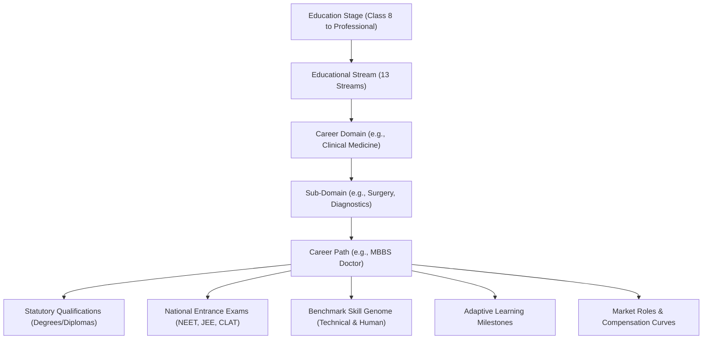

# KAABIL — Universal Career Intelligence Engine (Docs)

## 1. Executive Summary

The **KAABIL Universal Career Intelligence Engine** is an enterprise-grade, database-driven career knowledge and recommendation architecture. It is specifically designed to dismantle the engineering/technology monoculture in Indian career guidance by providing parity, statutory rigor, and structured pathways across **all 13 educational streams recognized under Indian higher education**.

KAABIL operates on a 3-layer hybrid intelligence paradigm:
1. **Layer 1: Structured Ground Truth Knowledge Base** — PostgreSQL database housing validated career pathways, regulatory statutory authorities, standardized entrance examinations, multi-tier compensation curves, and benchmark skill genomes.
2. **Layer 2: Deterministic Multi-Factor Recommendation Engine** — A transparent, explainable scoring algorithm (Interest 30%, Stream 20%, Skill 20%, Goals 20%, Preferences 10%) producing deterministic compatibility metrics without black-box bias.
3. **Layer 3: Generative AI Reasoning Layer** — Google Gemini 2.0 Flash integration providing contextualized, empathetic career guidance in English, Hindi, and Hinglish with strict Zod schema validation and automatic fallback.

---

## 2. Configurable Career Hierarchy

To ensure long-term scalability without rewriting application logic, career data is modeled in a multi-level configurable taxonomy:

---

## 3. All-Streams Coverage & Statutory Governance

Every career path in KAABIL is anchored to authoritative Indian statutory bodies, government councils, and gazette standards:

| Educational Stream | Primary Domain Example | Governing Statutory Council | Key Entrance Exams | Typical Duration |
| :--- | :--- | :--- | :--- | :--- |
| **Medical (PCB)** | Clinical Medicine & Surgery | National Medical Commission (NMC) | NEET-UG, NEET-PG | 5.5 + 3 Yrs |
| **Dental** | Dental Surgery | Dental Council of India (DCI) | NEET-UG, NEET-MDS | 5 Yrs |
| **Pharmacy** | Clinical Pharmacy | Pharmacy Council of India (PCI) | GPAT, State CET | 4 to 6 Yrs |
| **Non-Medical (PCM)** | Systems Engineering & AI | All India Council for Technical Education (AICTE) | JEE Main, JEE Advanced | 4 Yrs |
| **Aerospace** | Propulsion & Space Systems | AICTE / ISRO Benchmarks | JEE Advanced, GATE | 4 to 6 Yrs |
| **Commerce** | Accounting & Auditing | Institute of Chartered Accountants of India (ICAI) | CA Foundation, Inter, Final | 4.5 to 5 Yrs |
| **Investment Banking** | Capital Markets & Valuation | SEBI / CFA Institute | CAT, CFA, NISM | 3 to 5 Yrs |
| **Law** | Corporate Law & Litigation | Bar Council of India (BCI) | CLAT, AILET | 5 Yrs Integrated |
| **Judiciary** | Civil Judge Magistrate | High Courts / State Public Service Commissions | Judicial Services Exam | 5 Yrs + Bar |
| **Humanities** | Public Administration | UPSC / DoPT | Civil Services Examination (CSE) | Graduation + 1 Yr Prep |
| **Clinical Psychology** | Mental Health Practice | Rehabilitation Council of India (RCI) | CUET-PG, M.Phil Clinical Psy | 5 to 7 Yrs |
| **Design** | UI/UX & Spatial Design | National Institute of Design (NID) / CoA | NID DAT, UCEED, NATA | 4 to 5 Yrs |
| **Agriculture** | Agronomy & Soil Science | Indian Council of Agricultural Research (ICAR) | ICAR AIEEA, State Agri CET | 4 Yrs |
| **Vocational Trades** | Mechatronics & Precision Machining | Directorate General of Training (DGT / NCVT) | CTS / AITT (Trade Test) | 1 to 2 Yrs |
| **Sports & Physical Ed** | High Performance Coaching | Sports Authority of India (SAI) / NSNIS | NIS Diploma, BPED | 1 to 3 Yrs |
| **Hospitality & Tourism** | Executive Hotel Management | National Council for Hotel Management (NCHMCT) | NCHMCT JEE | 3 Yrs |

---

## 4. Database Models & Schema Extensions

In Part B, five core relational models were added to Prisma schema to support personalized career discovery:

1. **`SavedCareer`**:
   - `id`: CUID primary key
   - `studentId`: Foreign key to `StudentProfile`
   - `careerSlug`: Identifier for target career
   - `notes`: Optional student notes
   - `savedAt`: Timestamp
   - Unique constraint: `[studentId, careerSlug]`

2. **`SavedComparison`**:
   - `id`: CUID primary key
   - `studentId`: Foreign key to `StudentProfile`
   - `title`: User-defined comparison label
   - `careerSlugs`: JSON array storing compared career slugs (up to 4)
   - `createdAt`: Timestamp

3. **`RecommendationFeedback`**:
   - `id`: CUID primary key
   - `studentId`: Foreign key to `StudentProfile`
   - `careerSlug`: Target career evaluated
   - `rating`: 1 to 5 integer rating
   - `feedbackType`: Enum (`POSITIVE`, `NEUTRAL`, `NEGATIVE`)
   - `comment`: User explanation
   - `createdAt`: Timestamp

4. **`StreamDiscoveryResult`**:
   - `id`: CUID primary key
   - `studentId`: Foreign key to `StudentProfile`
   - `answers`: JSON record of diagnostic questionnaire responses
   - `primaryStream`: Recommended stream code
   - `compatibilityScore`: Heuristic match percentage (0-100)
   - `bridgeStreams`: JSON array of alternative bridge pathways
   - `evaluatedAt`: Timestamp

5. **`AiUsageLog`**:
   - `id`: CUID primary key
   - `studentId`: Foreign key to `StudentProfile`
   - `feature`: Module identifier (`CAREER_DISCOVERY`, `STREAM_ASSISTANT`)
   - `provider`: Model identifier (`GEMINI_2_FLASH`, `DETERMINISTIC_FALLBACK`)
   - `promptTokens`: Token count
   - `responseTokens`: Token count
   - `durationMs`: API response latency in milliseconds
   - `status`: Execution status (`SUCCESS`, `TIMEOUT`, `FALLBACK`)
   - `createdAt`: Timestamp

---

## 5. API Endpoints

The Career Intelligence Engine exposes high-performance REST APIs:

- `GET /api/careers`: Returns all career paths with optional stream and keyword filters.
- `GET /api/careers/[slug]`: Returns deep metadata for a single career path.
- `POST /api/careers/compare`: Validates up to 4 career slugs and returns comparative matrix data.
- `POST /api/careers/eligibility`: Checks student academic stage, subjects, and age against regulatory prerequisites.
- `POST /api/careers/save` & `DELETE /api/careers/save`: Toggles bookmarking of careers for authenticated students.
- `GET /api/careers/saved`: Retrieves all saved career slugs for the active user.
- `GET /api/student/recommendations`: Calculates Layer 2 & Layer 3 personalized career recommendations.
- `POST /api/student/recommendations/feedback`: Persists explicit student feedback on recommendation quality.
- `POST /api/student/stream-discovery`: Evaluates 6-step diagnostic responses and generates stream advice.
