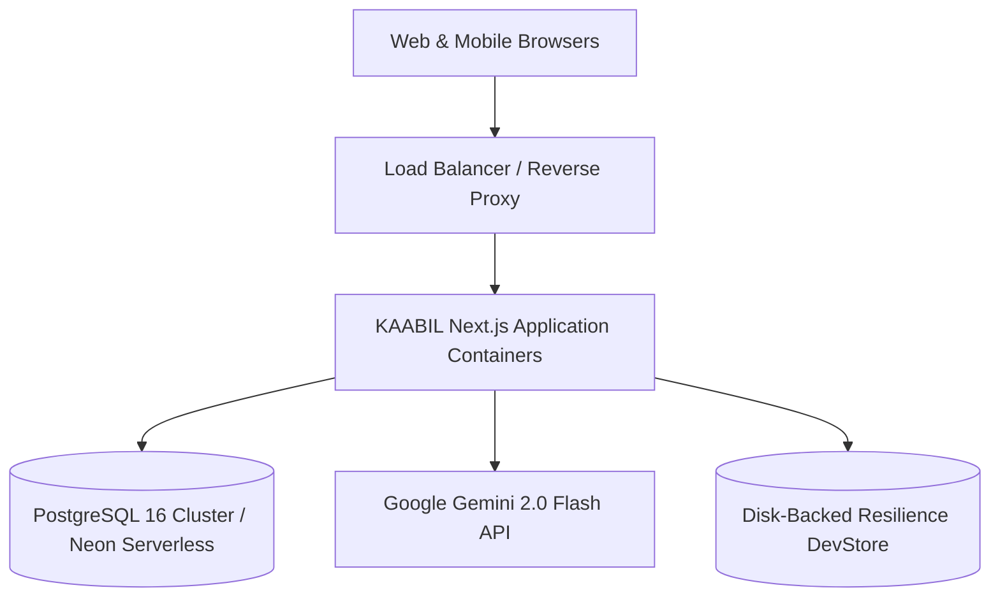

# KAABIL (काबिल) — Production Deployment & Operations Guide

**Platform Tagline:** Discover Your Skills. Define Your Future.  
**Core Principle:** Every Stream. Every Skill. Every Future.  
**Target Environment:** Linux / Docker / Cloud (Vercel, AWS, GCP, Neon PostgreSQL)  
**Version:** 1.0.0 Production  

---

## 1. Production Architecture Overview

KAABIL is built as a modular Next.js 14 App Router application paired with a PostgreSQL database layer managed through Prisma ORM.



---

## 2. Recommended Deployment Architectures

### Architecture A: Containerized Deployment (Docker / Kubernetes / AWS ECS)

Best for private cloud, university on-premises servers, or enterprise multi-tenant deployments.

1. **Prerequisites:**
   - Docker Engine 24+ & Docker Compose v2+
   - Registered domain with TLS/SSL termination (NGINX, Caddy, or Cloudflare)
2. **Execution:**
   ```bash
   # 1. Clone or unpack the repository
   cd kaabil

   # 2. Configure production secrets
   cp .env.example .env
   # Edit .env with your real POSTGRES_PASSWORD, AUTH_SECRET, and GEMINI_API_KEY

   # 3. Spin up full stack (PostgreSQL + KAABIL app)
   docker-compose up -d --build

   # 4. Verify deployment health
   curl -i http://localhost:3000/api/health
   ```

### Architecture B: Serverless Cloud Deployment (Vercel + Neon PostgreSQL)

Best for high-scale public SaaS with zero infrastructure maintenance.

1. **Database Setup:**
   - Create a free or production database on [Neon.tech](https://neon.tech) in AWS `ap-southeast-1` or nearest region.
   - Copy the connection string: `postgresql://<user>:<password>@<host>/<dbname>?sslmode=require`.
2. **Database Migration:**
   ```bash
   DATABASE_URL="<your-neon-url>" npx prisma migrate deploy
   DATABASE_URL="<your-neon-url>" npm run db:seed
   ```
3. **Vercel Project Configuration:**
   - Link repository to Vercel.
   - Configure Environment Variables in Vercel Project Settings:
     - `DATABASE_URL`: Your Neon PostgreSQL pooling connection string.
     - `AUTH_SECRET`: Generated 32+ character random hex string (`openssl rand -base64 32`).
     - `NEXTAUTH_URL`: `https://your-domain.com`.
     - `CREDENTIAL_SIGNING_SECRET`: Generated 32+ character secret for HMAC credential signing.
     - `GEMINI_API_KEY`: Your production Google AI Studio key.
     - `GEMINI_MODEL`: `gemini-2.0-flash`.
     - `NEXT_PUBLIC_APP_ENV`: `production`.
     - `NEXT_PUBLIC_APP_URL`: `https://your-domain.com`.
     - `NEXT_PUBLIC_DEMO_MODE`: `false`.
4. **Trigger Deployment:**
   - Vercel automatically runs `npm run build` and provisions serverless edge functions.

---

## 3. Database Migration, Seed & Backup Procedures

### 3.1 Applying Schema Migrations

In production, never run `npx prisma db push`. Always apply versioned migrations:
```bash
# Apply pending migrations
npx prisma migrate deploy

# Verify schema synchronization
npx prisma migrate status
```

### 3.2 Seeding Reference Data

Seed standard educational streams, careers, and standardized assessment rubrics:
```bash
npm run db:seed
```

### 3.3 Safe Database Backup Routine

Run automated daily logical backups with `pg_dump`:
```bash
# Automated daily backup script
TIMESTAMP=$(date +%Y%m%d_%H%M%S)
BACKUP_DIR="/var/backups/kaabil_db"
mkdir -p "$BACKUP_DIR"

pg_dump -U postgres -h localhost -d kaabil_prod -Fc -f "$BACKUP_DIR/kaabil_backup_$TIMESTAMP.dump"

# Retain backups for 30 days
find "$BACKUP_DIR" -type f -name "*.dump" -mtime +30 -delete
```

### 3.4 Disaster Recovery & Restoration

To restore from a logical backup dump:
```bash
# 1. Terminate active sessions (if restoring in emergency)
psql -U postgres -c "SELECT pg_terminate_backend(pid) FROM pg_stat_activity WHERE datname = 'kaabil_prod' AND pid <> pg_backend_pid();"

# 2. Restore database
pg_restore -U postgres -h localhost -d kaabil_prod -c --if-exists -v "/var/backups/kaabil_db/kaabil_backup_target.dump"
```

---

## 4. Production Security & Secret Management

1. **Secret Storage:**
   - Never commit `.env` or `.env.local` to version control.
   - In containerized environments, use Docker Secrets, HashiCorp Vault, or AWS Secrets Manager.
2. **Key Rotation Protocol:**
   - `AUTH_SECRET`: Rotate quarterly. Active sessions will require re-login upon rotation.
   - `CREDENTIAL_SIGNING_SECRET`: Keep existing signing keys in a verification ring if rotating, to prevent invalidating previously issued student skill passports.
   - `GEMINI_API_KEY`: Rotate via Google Cloud Console without downtime.
3. **Security Headers:**
   - Verified active in `next.config.mjs` including `Strict-Transport-Security`, `X-Frame-Options: SAMEORIGIN`, `X-Content-Type-Options: nosniff`, and privacy-preserving `Permissions-Policy`.

---

## 5. Monitoring & Health Probes

The application provides an enterprise health endpoint at `/api/health`:

```bash
# Probe platform health
curl http://localhost:3000/api/health
```

Example response:
```json
{
  "status": "healthy",
  "service": "kaabil-platform",
  "version": "1.0.0",
  "environment": "production",
  "timestamp": "2026-11-20T11:15:00.000Z",
  "uptimeSeconds": 86420,
  "database": {
    "provider": "postgresql",
    "connected": true,
    "message": "PostgreSQL database connection verified."
  },
  "aiServices": {
    "provider": "google-gemini",
    "configured": true,
    "model": "gemini-2.0-flash",
    "fallbackMode": "standby"
  }
}
```
