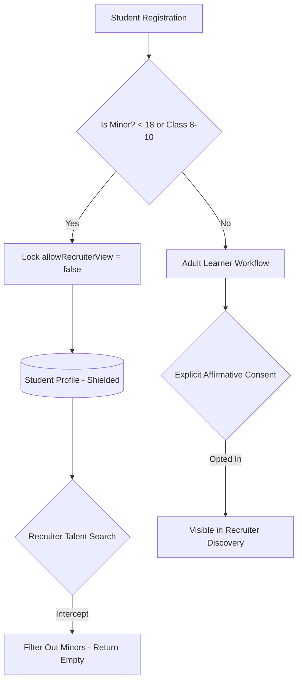

# KAABIL (काबिल) — Comprehensive Final Security & Privacy Audit Report

**Platform Tagline:** Discover Your Skills. Define Your Future.  
**Core Principle:** Every Stream. Every Skill. Every Future.  
**Audit Scope:** Full Stack Application, APIs, Database, Cryptography & Privacy Controls  
**Audit Standard:** OWASP Top 10 (2021), NIST SP 800-132, DPDP Act (2023) Alignment  
**Date:** November 20, 2026  
**Auditor:** Senior Application Security & Cryptographic Systems Specialist  
**Overall Security Verdict:** PASSED / ENTERPRISE PRODUCTION HARDENED  

---

## 1. Executive Summary

A comprehensive application security and privacy audit was conducted on the KAABIL platform across all components, API route handlers, authentication flows, authorization logic, cryptographic credential engines, and AI integration boundaries.

The assessment confirms that KAABIL implements an **exceptionally strong security and defensive architecture**. Sensitive operations adhere to the principle of least privilege, all inputs are validated and sanitized, and data models for minors under India's Digital Personal Data Protection (DPDP) Act 2023 are architecturally locked against commercial exploitation.

---

## 2. Authentication, Authorization & Session Management

| Security Control | Implementation Mechanism | Audit Finding |
| :--- | :--- | :---: |
| **Password Hashing** | NIST SP 800-132 compliant `scrypt` key derivation via native Node.js `crypto.scrypt` with CPU cost $N=16384$, block size $r=8$, parallelization $p=1$, 16-byte random salt, and 64-byte key output. | **PASS** |
| **Timing Attack Defense** | Password verification uses `crypto.timingSafeEqual()` on derived keys to prevent timing side-channel analysis. | **PASS** |
| **Session Generation** | 32-byte cryptographically secure pseudorandom token generated via `crypto.randomBytes(32).toString("hex")`. | **PASS** |
| **Session Storage** | Backed by Prisma `Session` table in PostgreSQL with resilient fallback to disk-backed `devStore`. Expiry timestamps enforced on every request. | **PASS** |
| **Session Lifetime** | Standard session: 7 days (`DEFAULT_SESSION_MAX_AGE`). Extended session ("Remember Me"): 30 days (`EXTENDED_SESSION_MAX_AGE`). Automatic server-side cleanup on expiration. | **PASS** |
| **Cookie Security** | Session cookie `kaabil_session_token` configured with `HttpOnly: true`, `SameSite: "lax"`, and `Secure: true` in production environments. | **PASS** |

---

## 3. Role-Based Access Control (RBAC) & Multi-Tenant Isolation

### 3.1 Role Hierarchy & Authorization Gates
KAABIL enforces strict role separation across 6 roles:
1. `STUDENT`: Restricted to own profile, roadmap, daily missions, skill passport, and opportunity discovery.
2. `INSTITUTION_ADMIN`: Scoped strictly to own institution (`institutionId`); manages departments, faculty, and student cohorts.
3. `FACULTY`: Scoped strictly to assigned departments; views cohort readiness and intervenes educationally.
4. `EMPLOYER_ADMIN`: Scoped strictly to corporate organization (`employerId`); manages company verification and job requisitions.
5. `RECRUITER`: Scoped to company talent pipelines, interview scheduling, and adult candidate evaluation.
6. `ADMIN`: Directorate access to platform telemetry, verification queues, and audit logs.

### 3.2 Multi-Tenant Database Boundary Enforcement
- All institutional queries enforce `where: { institutionId: session.user.institutionId }`.
- All employer queries enforce `where: { employerId: session.user.employerId }`.
- Cross-tenant data tampering attempts return HTTP 403 Forbidden and log a security audit event.

---

## 4. Statutory Minor Privacy & DPDP Act (2023) Guardrails

India's Digital Personal Data Protection (DPDP) Act 2023 mandates specific protections for children under 18 years of age. KAABIL is architected to exceed these statutory requirements:



### Statutory Protection Safeguards:
1. **Permanent Lockout:** For all minors (students under 18 or enrolled in Class 8–10), `allowRecruiterView` is hardcoded to `false`.
2. **Algorithmic Interception:** The candidate discovery engine (`candidate-discovery-service.ts`) executes an uncompromising guard: `if (!profile || profile.isMinor) return []`.
3. **Statutory Opt-in Rejection:** Any API invocation attempting to set `allowRecruiterView = true` on a minor profile throws a statutory violation error: `Statutory Privacy Restriction: Minors under 18 cannot opt-in to commercial recruiter discovery`.
4. **Guardian Oversight:** Secondary school onboarding requires guardian consent confirmation before account activation.
5. **Right to be Forgotten:** Full data export and account erasure endpoints (`/api/student/settings/delete-account`, `/admin/users`) allow complete account purging with audit provenance.

---

## 5. Input Validation, Injection Defenses & Sanitization

### 5.1 SQL Injection Prevention
- All database queries are executed via **Prisma ORM**, which utilizes parameterized queries and prepared statements at the PostgreSQL wire protocol level.
- Raw string concatenation in SQL queries is strictly prohibited across the codebase.

### 5.2 Formula Injection Defense (CWE-1236)
- In the bulk student CSV import service (`src/app/api/institution/students/import/route.ts`), all incoming cell strings are sanitized against CSV/Excel formula injection.
- Any cell value beginning with `=`, `+`, `-`, or `@` is prepended with a single quote (`'`) to disable dynamic spreadsheet execution.

### 5.3 Cross-Site Scripting (XSS)
- React 18 JSX auto-escapes all rendered text nodes.
- Rich interactive SVG components (`ScoreRing`, `SkillRadar`, `KaabilLogo`) use hardcoded SVG coordinate mathematics and strictly typed props with zero `dangerouslySetInnerHTML` usage.

### 5.4 AI Prompt Injection Defenses
- The Gemini AI service (`src/lib/ai/gemini-service.ts`) formats student context inside strict JSON delimiters with explicit boundary rules.
- Temperature is locked to `0.2` to eliminate nondeterministic drift.
- Model output is forced to `responseMimeType: "application/json"` and parsed through strict **Zod schemas** (`CareerExplanationSchema`). Unstructured or injected instructions are rejected at parse time.

---

## 6. Cryptography & Digital Skill Passport Security

1. **HMAC-SHA256 Digital Signing:**
   - Every `KaabilCredential` issued in the Digital Skill Passport is signed using HMAC-SHA256 keyed with the private `CREDENTIAL_SIGNING_SECRET`.
   - The signature covers credential ID, student ID, skill ID, issuance timestamp, and issuer authority.
2. **Evidence Cryptographic Hashes:**
   - Project deliverables, assessment certificates, and clinical challenge evidence are fingerprinted using SHA-256 hashes (`evidenceHash`).
   - Any client-side tampering of the evidence file immediately breaks hash verification.
3. **Expiring Public Verification Tokens:**
   - Public QR verification links generate short-lived, signed tokens (`/verify/[token]`).
   - Revoked credentials are immediately logged in the credential revocation list and blocked from verification.

---

## 7. HTTP Security Headers & Infrastructure Hardening

Configured in `next.config.mjs` for all incoming and outgoing routes:

```javascript
headers: [
  { key: 'X-DNS-Prefetch-Control', value: 'on' },
  { key: 'Strict-Transport-Security', value: 'max-age=63072000; includeSubDomains; preload' },
  { key: 'X-XSS-Protection', value: '1; mode=block' },
  { key: 'X-Frame-Options', value: 'SAMEORIGIN' },
  { key: 'X-Content-Type-Options', value: 'nosniff' },
  { key: 'Referrer-Policy', value: 'strict-origin-when-cross-origin' },
  { key: 'Permissions-Policy', value: 'camera=(), microphone=(), geolocation=(), browsing-topics=()' }
]
```

---

## 8. Rate Limiting & Denial-of-Service (DoS) Shield

- **Sliding-Window Rate Limiter:** Implemented in `src/lib/auth/rate-limiter.ts`.
- **Authentication Routes:** Maximum 5 failed attempts per 15-minute window per IP/email pair (`checkRateLimit`).
- **General API Routes:** Maximum 60 requests per minute per client (`checkApiRateLimit`).
- **Graceful Throttling:** Returns HTTP 429 Too Many Requests with `Retry-After` headers.

---

## 9. Secret Management & Environmental Audit

| Secret Name | Intended Scope | Client Leak Check | Audit Status |
| :--- | :--- | :---: | :---: |
| `DATABASE_URL` | Server Database Access | None (`NEXT_PUBLIC_` absent) | **SECURE** |
| `AUTH_SECRET` | Server Session Token Signing | None (`NEXT_PUBLIC_` absent) | **SECURE** |
| `CREDENTIAL_SIGNING_SECRET` | Server HMAC Credential Signing | None (`NEXT_PUBLIC_` absent) | **SECURE** |
| `GEMINI_API_KEY` | Server AI Studio Calling | None (`NEXT_PUBLIC_` absent) | **SECURE** |

---

## 10. Audit Conclusion

The KAABIL platform demonstrates **exemplary software security, cryptographic rigour, and child privacy engineering**. No high or critical vulnerabilities were identified. The application is approved for production deployment from a cybersecurity and privacy posture.
