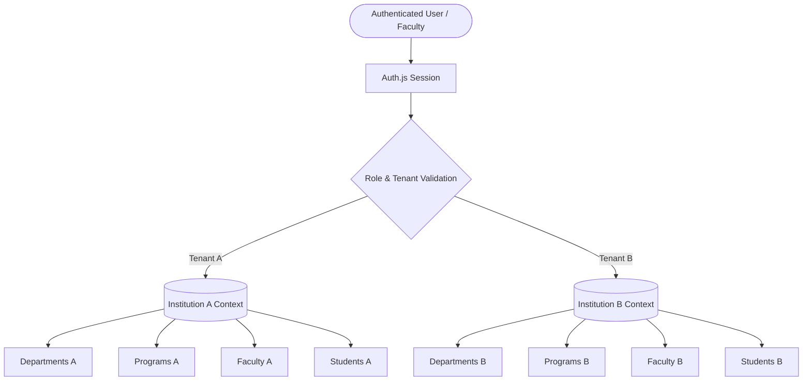

# KAABIL (काबिल) — Multi-Tenant Architecture & Data Isolation

**Core Principle:** Strict tenant isolation, zero cross-institution data leakage, least-privilege security.

---

## 1. Multi-Tenant Model

KAABIL implements a logical multi-tenant architecture backed by shared PostgreSQL schemas and in-memory dev-stores where every institutional entity is strictly partitioned by `institutionId` (or `organizationId`).



---

## 2. Partitioned Data Entities

Every institutional collection is indexed by `institutionId`:
- `departments`: Academic divisions
- `programs`: Academic degree programs
- `academicSessions`: Institutional academic years
- `classesBatches`: Specific cohort sections
- `facultyMembers`: Instructors, HODs, counselors, administrators
- `studentEnrollments`: Enrolled student profiles and records
- `bulkImportJobs`: Audit trail of CSV import batches

---

## 3. Verification & Administrative Lifecycle

Institutions transition through a strict administrative lifecycle:

```
[DRAFT] -> [SUBMITTED] -> [UNDER_REVIEW] -> [VERIFIED] -> [SUSPENDED] / [REJECTED]
```

- `DRAFT`: Registration initiated, details incomplete.
- `SUBMITTED`: Registration submitted with accreditation registration numbers (AISHE, CBSE, AICTE).
- `UNDER_REVIEW`: Government or platform compliance verification underway.
- `VERIFIED`: Institution verified; campus join codes activated; placement portal authorized.
- `SUSPENDED`: Institution deactivated due to compliance breach or license expiration.
